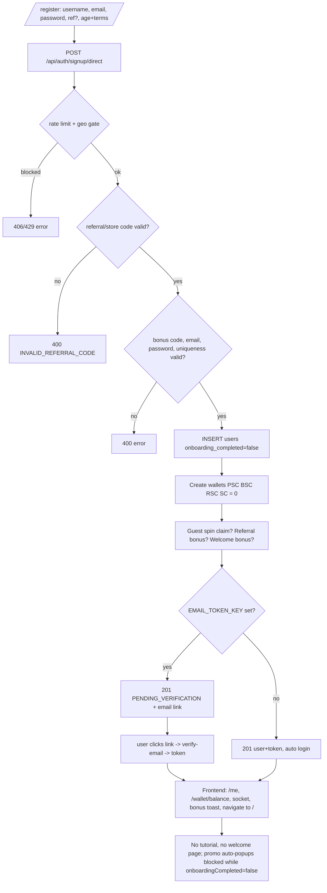
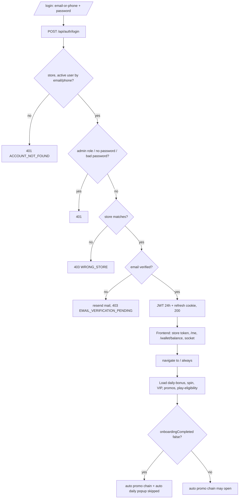
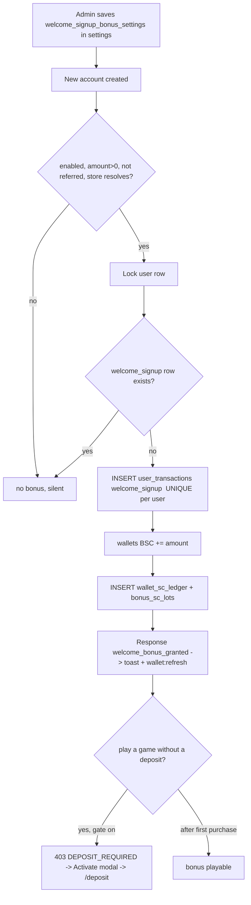
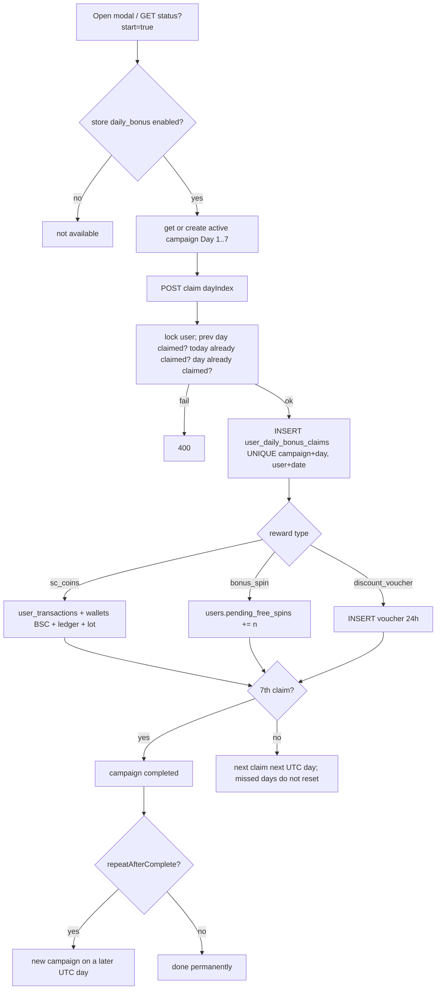
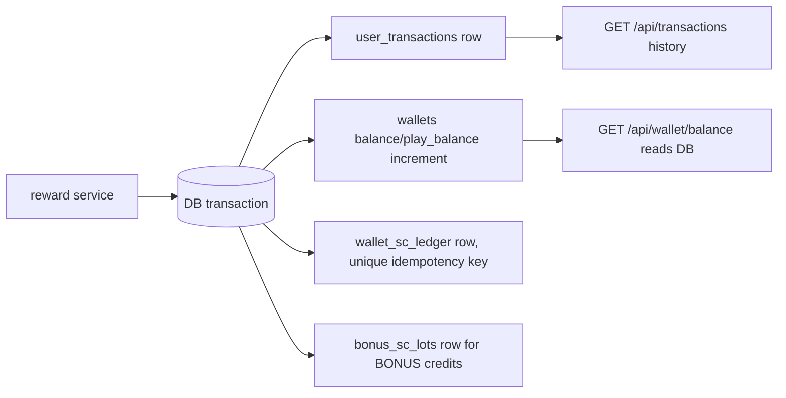

# Golden Dragon (DragonFury codebase) — Existing Flow Audit

**Type:** READ-ONLY audit. Nothing was changed: no code, DB, API, config, migration or table. The only file created is this report.
**Date:** 2026-10-14
**Scope:** registration, login, welcome bonus, daily login rewards, wallet/reward history, DB structure, frontend↔backend wiring, tests.
**Not assumed:** this report does **not** assume the code behaves like goldendragon.casino. It states only what the code and the local database contain.

## How this audit was done (and its limits)

- **Code:** every finding comes from reading the source (three parallel read-only reviews + my own spot checks). File paths and line numbers are cited. Line numbers are from the working tree on 2026-10-14 and may drift.
- **Database:** only read-only metadata and **aggregate counts** were run against the local PostgreSQL database `dragonfury_restored` (schema, constraints, indexes, `COUNT`/`GROUP BY`). No personal rows, no credentials, no tokens were read or are shown here.
- **Nothing was executed against the app:** no signup, login, claim, spin or balance change was made. No API was called.
- **Local DB is a restored copy of real production-like data** (4,684 users, 18,708 wallet rows, 200,621 `user_transactions`). Counts below therefore describe historical production behaviour for *other* stores, not the `goldendragon` store (which has **3 users** locally).
- **Evidence levels used in the status tables:**
  - `CODE` = read in source.
  - `DATA` = database rows/constraints that the feature produced or enforces.
  - `TEST` = automated test (none exist).
  - `RUN` = executed during this audit (none; audit was read-only).
- Paths: `BE` = `backend/src`, `FE` = `frontend/src`, `ADM` = `admin/src`.

---

## A. Current project architecture

| Layer | Technology / fact | Evidence |
|---|---|---|
| Frontend (player site) | Vite + React SPA, dev port 5173. `frontend/` | `frontend/vite.config.js`, `FE/App.jsx` |
| Admin panel | Vite + React SPA (separate app), dev port 5175 locally. `admin/` | `ADM/App.jsx` |
| Backend | Node.js + Express + Sequelize, port 8080. `backend/` | `backend/index.js`, `BE/rest-resources/routes/index.js` |
| Database | PostgreSQL (`dragonfury_restored` locally) | `BE/db/models`, `BE/db/migrations` |
| Realtime | Socket.IO (live wallet balance push) | `BE/services/realtime/socket.service.js`, `FE/context/AuthContext.jsx:219-261` |
| Email | Mailgun (`BE/utils/email.js`) — **not configured locally** | `BE/utils/email.js:198-274` |
| Phone verification | Didit (optional, per-store toggle, default OFF) | `BE/services/phone/phoneSettings.service.js:11` |
| Fraud / device | Fingerprint Pro (optional, per-store enforce list, default empty) | `BE/services/auth/fingerprintSignup.service.js:31,51-56` |
| Geo restriction | ipgeolocation (`geoGate`), fails open on provider error | `BE/rest-resources/middlewares/geoBlock.middleware.js:401-507` |
| Push | Firebase (optional) | `FE/components/PushPermissionPrompt.jsx` |

### Multi-tenancy ("store code")
- One backend serves many stores. A store exists as a `users` row with `role='store_admin'` (that row supplies `distributor_code`). `BE/services/auth/storeBinding.helpers.js:20-38`.
- Frontend store code: `VITE_STORE_CODE` env, fallback `'dragonfury'` (`FE/config/site.js:7-9`). Local `frontend/.env.local` = `goldendragon`. It is **not** derived from host or URL on the frontend.
- The frontend sends it as `clientStoreCode` in auth bodies and an `X-Store-Code` header. The backend auth code ignores the header and uses the body field (`FE/api/auth.js:11-15`, `FE/services/request.js:120-156`).
- Per-store feature settings live in the generic `settings` table (key + `distributor_code` + `store_code` + JSON `value`), e.g. `daily_bonus_settings`, `welcome_signup_bonus_settings`, `spin_wheel_settings`, `phone_verification`.

### Authentication (how it works)
- **Access token:** HS256 JWT, claims `userId, username, email, role, distributorCode, storeCode`; lifetime `JWT_LOGIN_TOKEN_EXPIRY` default `24h`. `BE/helpers/authentication.helpers.js:4-19`, `BE/configs/app.config.js:42-47`. No `jti`, no revocation.
- **Refresh token:** separate JWT (30d) in an httpOnly cookie `refreshToken`. `BE/helpers/authentication.helpers.js:21-43`, `BE/rest-resources/controllers/auth.controller.js:9-51`.
- **Frontend storage:** access token in `localStorage['token']` (`FE/services/storageUtils.js:1-30`); sent as `Authorization: Bearer`, with `credentials:'include'` (`FE/services/request.js:120-156`).
- **Verification:** `authMiddleware` only runs `jwt.verify` and fills `req.user` from claims — **no DB lookup** (`BE/rest-resources/middlewares/auth.middleware.js:4-28`). Therefore a deactivated user's token stays valid until it expires.
- **Frontend user state:** `AuthContext` calls `GET /api/auth/me` then `GET /api/wallet/balance`, opens Socket.IO (`FE/context/AuthContext.jsx:90-261`). It rejects admin roles and a `storeCode` that is not this site's store (`:100-111`).
- **Refresh flow is unused by the frontend:** `POST /api/auth/refresh-token` exists, but nothing in `FE/` calls it; any 401/403 clears the token and forces re-login (`FE/services/request.js:88-105`, `FE/components/Layout.jsx:181-187`). `POST /api/auth/logout` is also never called by the frontend.
- **Password transport:** the client base64-encodes the password (`FE/utils/passwordEncrypt.js`). This is obfuscation, not encryption (`BE/utils/passwordEncryption.js:16-48`).

### Key route groups (backend)
| Area | Mount / route | File |
|---|---|---|
| Auth | `/api/auth/*` (register, signup/direct, login, google, google/code, facebook, verify-email, refresh-token, me, complete-onboarding) | `BE/rest-resources/routes/auth.routes.js` |
| Wallet | `/api/wallet/balance` | `BE/rest-resources/routes/wallet.routes.js:9` |
| Daily bonus | `/api/daily-bonus/*` | `BE/rest-resources/routes/dailyBonus.routes.js`, mounted `routes/index.js:115` |
| Welcome bonus | `/api/welcome-signup-bonus/*` | `BE/rest-resources/routes/welcomeSignupBonus.routes.js`, mounted `routes/index.js:112` |
| Spin wheel | `/api/spinwheel/*` | `BE/rest-resources/routes/spinWheel.routes.js` |
| Transactions | `/api/transactions` | `BE/rest-resources/routes/transactions.routes.js:8` |
| Game play gate | `/api/games/play-eligibility` | `BE/rest-resources/routes/games.routes.js:17` |

### Environment facts that change behaviour (names only; no values read)
- Local `backend/.env` has **no** `EMAIL_TOKEN_KEY`, **no** `MAILGUN_*`, **no** `GOOGLE_*`, **no** `FACEBOOK_*`, **no** payment-password key. Consequence locally: email verification is **off** (signup auto-logs-in), Google/Facebook sign-in is **not configured**.
- Production boot refuses weak JWT secrets (`backend/index.js:15-24`).

---

## B. Complete new-user registration flow

### Frontend
1. Routes `/register`, `/signup` → `AuthView` → `AuthPage mode="signup"` → `DragonFurySignupPage` → `DragonFurySignupForm` (`FE/App.jsx:437-440`, `FE/components/AuthView.jsx`).
2. Query params read: `?ref` / `?affiliate` (referral code), `?bonusCode` / `?bc` (bonus code) — `FE/components/Auth/AuthPage.jsx:29-30`.
3. **Fields actually rendered** (`DragonFurySignupForm.jsx:55-102`; schema `FE/components/Auth/constants/validation.js:37-56`):

| Field | Required | Client rule |
|---|---|---|
| Username | Yes | 3–255 chars |
| Email | Yes | Yup email |
| Password | Yes | 8+ chars, upper, lower, digit, special |
| Referral code | No | max 64 |
| Age checkbox | Yes | "at least 21 and not a resident of Restricted states" |
| Terms/Privacy checkbox | Yes | — |

   First/last name are **not** in the UI (sent as empty strings, `AuthPage.jsx:161-162`). No phone, DOB, captcha or OTP in the signup UI.
4. Submit → `AuthContext.register` → `authApi.signupDirect` → `POST /api/auth/signup/direct` with base64 password, `code: STORE_CODE` (always sent), `clientStoreCode`, optional `ref`, `bonusCode`, guest-spin fields, optional Fingerprint `requestId` (`FE/api/auth.js:26-32`, `AuthPage.jsx:152-191`).

### Backend (route → controller → service)
`authRateLimiter` (60/min/IP prod) → `geoGate` → `auth.controller.register` → `services/auth/register.service.js` (`BE/rest-resources/routes/auth.routes.js:10-14`, `controllers/auth.controller.js:53-80`).

**Geo gate** (`geoBlock.middleware.js:401-507`): skipped for crawlers and when the store's `geo_block` setting is disabled; passes allowlisted IPs; skipped when `IPGEO_*` env is missing; otherwise blocks (HTTP 406) VPN/non-allowed countries; provider errors **fail open**.

**Validations, in order** (`BE/services/auth/register.service.js`):
1. Referral / store code: `ref`/`affiliateCode` must match a user's `user_referral_code`; otherwise `code` is tried as referral code, then as a `store_admin.storeCode`; no match → 400 `INVALID_REFERRAL_CODE` (`:62-128, 149-153`). A referred user is bound to the **referrer's** store.
2. Bonus code (optional): must exist for the store, active, `bonus_type='deposit'`, not an email-campaign code (`resolveSignupBonusCodeForRegister.service.js`).
3. Email regex; password strength (`BE/utils/common.js:3-25`).
4. Uniqueness: email per store; username per store (`:209-237`).
5. Names: required **only if** payment API is configured **and** the payment encryption key is set; letters only (`:246-261`). Working-tree edit in this file (uncommitted).
6. Device policy (Fingerprint): only if configured and store is in the enforced list (default empty) (`fingerprintSignup.service.js:241-295`).
7. **Not present:** captcha, server-side age/DOB check (age is UI checkbox only), phone requirement at signup, stored terms-acceptance.

**DB operations** (sequential, **not** wrapped in one transaction):
1. `INSERT users` — email, bcrypt password, username, `sign_in_type='NORMAL'`, `is_email_verified = !verificationEnabled`, `is_phone_verified=false`, `user_referral_code`, `user_referred_by`, `store_code`, `distributor_code`, `signup_bonus_code_id`, `device_visitor_id`; `onboarding_completed` = DB default `false` (`register.service.js:283-300`).
2. If payment API + key configured: create external payment account, update `users.payment_api_*`, insert `notifications` (`:331-408`).
3. `ensureUserWalletSet` → inserts 4 `wallets` rows (PSC, BSC, RSC, SC) at 0 (`BE/services/wallet/walletBuckets.service.js:96-101`).
4. Optional guest landing-spin claim → credits BSC (`claimGuestLandingSpin.service.js`).
5. Referral friend bonus (if referred) → `grantReferralFriendSignupBonus.service.js`.
6. Welcome signup bonus (if enabled and **not** referred) → see section D.
7. If email verification enabled: store `email_verification_token`, send Mailgun mail (`:464-478`).
8. There is **no** `referrals` table; the link is `users.user_referred_by`. Referral deposit rewards are paid later (`affiliate/applyReferralDepositReward.service.js`, table `referral_deposit_rewards`).

### Email / phone verification
- **Email:** enabled only when `EMAIL_TOKEN_KEY` (and expiry, default `5d`) is set (`register.service.js:270-272`). If on: response is 201 `{status:'PENDING_VERIFICATION', emailSent,...}` with **no token**; link `/check-email?emailToken=…`; `GET /api/auth/verify-email` sets `is_email_verified=true` and issues a token. **Verification is required for password login.** If off (local): `is_email_verified=true` and the user is auto-logged-in.
- **Phone:** **not part of signup or login.** `is_phone_verified=false` at creation. Didit OTP is used only at first purchase / to unlock bonus balance, and only if the per-store `phone_verification` setting is on (default OFF) — `BE/services/wallet/bonusScLock.service.js`, `FE/components/Auth/PhoneVerifyGateModal.jsx`. Components `SignupPhoneOtpPanel.jsx` / `LoginPhoneChallengeModal.jsx` are not imported anywhere (dead code).

### What happens immediately after successful registration
- API returns 201 `{user, token, guest_spin_*, welcome_bonus_granted, welcome_bonus_amount_sc, referral_friend_bonus_*}` (or `PENDING_VERIFICATION`). Refresh cookie is set.
- Frontend (`AuthPage.jsx:171-190`): bonus toasts + `wallet:refresh`; then either opens `EmailVerificationModal` (pending verification) or dispatches `notifications:refresh` and navigates to `/`. **There is no welcome page, no tutorial, no auto popup** (see C and I).

### Google / Facebook signup
- Full code exists on both sides: `POST /api/auth/google`, `/google/code`, `/facebook` (`BE/services/auth/googleAuth.service.js`, `facebookAuth.service.js`; `FE/components/Auth/DragonFurySSOButtons.jsx`, `FE/hooks/useGoogleIdentity.js`).
- **Not configured:** needs `GOOGLE_CLIENT_ID` (+`GOOGLE_CLIENT_SECRET` for redirect flow) and `VITE_GOOGLE_CLIENT_ID`; Facebook needs `FACEBOOK_APP_ID/SECRET` and `VITE_FACEBOOK_APP_ID`. Without them the backend returns 503 and the button is disabled/hidden.
- New SSO users go through the same wallet/bonus creation as email signup, email auto-verified. Existing email in the same store is **linked** and marked verified without checking Google's `email_verified` claim (`googleAuth.service.js`).
- Redirect OAuth flow is switched off in code (`FE/utils/googleAuth.js:36-38`).

---

## C. Complete login and returning-user flow

### Frontend
1. `/login`, `/signin`, `/register` all render `AuthPage`; form `DragonFuryLoginForm.jsx` (label "Username/Email").
2. `handleLoginSubmit` (`AuthPage.jsx:102-135`) lower-cases an email, otherwise formats the identifier as a US phone number; calls `AuthContext.login` → `POST /api/auth/login` (base64 password + `clientStoreCode`) (`FE/api/auth.js:45-53`).
3. On success: store token → client-side store check (`WRONG_STORE`) → `setUser` → `loadUser()` (`/me` again) → `navigate('/')`. Redirect is **always `/`**; `ProtectedRoute`'s `state.from` is never consumed.

### Backend (`BE/services/auth/login.service.js`)
Order: rate limit (20 failed/15 min/IP prod) → geo gate → resolve store → find **active** user by email **or phone** (usernames are **not** supported) → 401 if none (`ACCOUNT_NOT_FOUND`, reveals existence) → reject admin roles → reject password-less (OAuth-only) accounts → `bcrypt.compare` → store match/bind (`WRONG_STORE` 403) → optional bonus-code bind → if email unverified: re-send mail + 403 `EMAIL_VERIFICATION_PENDING` → issue JWT + refresh cookie → 200 `{user, token}`.

### Session / state / what loads after login
- DB writes at login: **only** optional `users.store_code` bind and `users.signup_bonus_code_id`. **No** `last_login` column or write exists. Login does not touch wallets, daily bonus, devices or game providers.
- Frontend then loads `/me`, `/wallet/balance`, opens Socket.IO, and `LayoutAuthOverlays` fetches daily-bonus status, dashboard promo config, spin status, VIP, affiliate, promotions, play-eligibility, notifications (`FE/components/LayoutAuthOverlays.jsx`).
- Phone OTP at login is intentionally skipped ("Allow login without phone OTP", `login.service.js:177`); the challenge path is unreachable.

### First login vs returning login
- The backend returns the same shape for both. First-time signals exist **only in the signup response** (`welcome_bonus_granted`, `guest_spin_claimed`, `referral_friend_bonus_granted`).
- The only first-login flag is `users.onboarding_completed` (default `false`). There is no `isFirstLogin`.
- **The onboarding tutorial is disabled in code:** start logic commented out and `onboarding_pending` actively removed (`FE/context/AuthContext.jsx:112-124`); `<OnboardingTutorial/>` mount commented out (`FE/components/LayoutAuthOverlays.jsx:12-15,169-173`). `POST /api/auth/complete-onboarding` is only called from inside `OnboardingTutorial.jsx:369`, so in the current UI **nothing sets `onboarding_completed=true`** (only the backend service `completeOnboarding.service.js:16` and an admin edit field can).
- **Side-effect (verified in code):** `useDashboardPromoModals.js:462-464` and `useDailyBonusPromoModal.js:106` return early when `user.onboardingCompleted === false`. The auto-popup promo chain (including the automatic daily-bonus popup) therefore does not start for accounts whose flag is `false`. The manual daily-bonus open still works.
- **DB context (aggregate):** among `role='user'` accounts, most have the flag `true` (e.g. 4,190 of 4,684 overall; 5 of 7 created in 2026-10) — consistent with the tutorial having set it before it was disabled. New accounts created with the current code start as `false`. This is an inference from code + counts; it was **not** reproduced by creating an account.

---

## D. Welcome bonus flow

**Summary:** automatic, granted **at registration** (not at login, no claim button). Amount is **Bonus SC (BSC)**, configured per store. **GC (Gold Coins) is not granted anywhere.** It is **disabled by default**.

### Configuration
- `settings` row, key `welcome_signup_bonus_settings`, per (distributor, store); JSON `{enabled, amountSc, modalImageUrl, requireDepositToActivateBonus}`. `BE/services/welcomeSignupBonus/welcomeSignupBonusSettings.service.js:11-22,92-116,360-429`.
- Code defaults: `enabled:false`, `amountSc:10`, `requireDepositToActivateBonus:true`. Max 10,000. No row → nothing granted.
- Admin API `/api/welcome-signup-bonus` (`GET /public`, `GET|PUT /admin/stores`, `PUT /admin/activate-bonus-modal`, `POST /admin/modal-image-upload`); admin UI `ADM/pages/WelcomeSignupBonus.jsx`, `ADM/pages/ActivateBonusModal.jsx` (real API wiring).
- **DATA:** rows exist for 8 other stores (amount 5 or 10 SC; some enabled, some disabled). **There is no row for `goldendragon`** → feature is OFF for that store until an admin saves one.

### Eligibility (`BE/services/wallet/grantWelcomeSignupBonus.service.js:43-166`)
User exists; customer (not admin role); **not referred** (referred users get the referral friend bonus instead, "never both"); store matches; store resolvable to an active `store_admin`; settings `enabled` and `amountSc>0`.

### Trigger and claim process
Triggered inside new-account creation of email register (`register.service.js:421-441`), Google (`googleAuth.service.js:307-327`) and Facebook (`facebookAuth.service.js:242-264`). Existing-account logins never grant. Granted **before** email verification. Not in the same DB transaction as user creation; wrapped in `tryGrantWelcomeSignupBonus` which **swallows errors** (no retry/backfill).

Steps: lock user row (`FOR UPDATE`) → look for existing `welcome_signup` row → bind store if empty → **insert `user_transactions` guard row first** → `creditBonusSc` → return `{granted, amount_sc}` → frontend toast + `wallet:refresh` (`FE/utils/guestSpinAuth.js:23-66`).

### DB updates
| Table.column | Operation |
|---|---|
| `user_transactions` (`type='welcome_signup'`, `amount`, `currency_code='BSC'`, `metadata`) | INSERT (guard row) |
| `wallets` (`currency_code='BSC'`): `balance`, `play_balance` | SQL increment |
| `wallet_sc_ledger` (`wallet_type='BONUS'`, `direction='CREDIT'`, `event_type='WELCOME_BONUS'`, `source_type='WELCOME_SIGNUP'`, `idempotency_key`) | INSERT |
| `bonus_sc_lots` (`bonus_type='WELCOME_BONUS'`, `original_amount`, `remaining_amount`, `expires_at=NULL`, `max_cashout=NULL`) | INSERT |
| `bonus_sc_lot_consumptions` | written later on BSC debits (FIFO) |

### Post-signup gate (not a claim)
`GET /api/games/play-eligibility` / `assertUserCanPlayGames`: a user with a `welcome_signup` (or referral) transaction and **no completed deposit** gets 403 `DEPOSIT_REQUIRED` (if store flag `requireDepositToActivateBonus` ≠ false) — `BE/services/games/gamePlayEligibility.service.js:109-162`. Frontend `DepositRequiredModal` ("Activate your welcome bonus") links to `/deposit` (`FE/components/Games/DepositRequiredModal.jsx`, `FE/hooks/useDepositRequiredGate.js`). The bonus SC is already in the wallet; the modal is a play gate.

### Can a user claim it more than once?
**No** (4 layers): app-level lookup under row lock; **partial unique index** `user_transactions_welcome_signup_once_uq (user_id) WHERE type='welcome_signup'` (`BE/db/migrations/20260720160000-welcome-signup-one-per-user.js`); user-row lock; unique `wallet_sc_ledger.idempotency_key`.
- **DATA verification:** the unique index exists in the DB; **0** users have more than one `welcome_signup` row (1,583 rows total, amounts 5.00 and 10.00).
- Limitation: it is per **account**, not per person/device/phone. Fingerprint protection is off by default.

### Wagering / expiry / cashout
Welcome lot has no expiry and no cashout cap. A 5× play-through exists but is hard-coded to the `dragonfury` store (`BE/services/wallet/bonusPlaythrough.constants.js:5`, `validateSpinWheelWithdrawal.service.js`).

### Related, separate bonuses
- **Referral friend signup bonus** (`grantReferralFriendSignupBonus.service.js`): credits wallet *before* inserting its guard row and has **no unique DB index** (only a row lock).
- **Bonus codes** (`bonus_codes`, `user_bonus_code_grants`, `users.signup_bonus_code_id`): only *bind* at signup; the credit happens **on deposit** (`applySignupBonusCodeOnDeposit.service.js`), unique `(deposit_request_id, bonus_code_id)`.
- Deposit "Welcome Packages" group visible 24 h after signup (`BE/constants/depositPackageGroups.js`).

### Hard-coded marketing text not tied to the real amount
`FE/config/homeConfig.js:77` ("CLAIM GC 150,000 + 2 SC", overridable via the home-page admin setting), `FE/components/Auth/DragonFurySignupPage.jsx:49` ("collect 150,000"), `FE/components/Home/GuestFinalCta.jsx:16` ("2 SC on signup"), `HowToPlaySection.jsx`, `landingFaq.js`. The real amount is only shown in the post-signup toast.

---

## E. Daily reward and streak flow

**Model:** a **per-user 7-step sequential "campaign"** with at most **one claim per UTC calendar day**. It is **not** a consecutive-day streak: missing a day does **not** reset anything. Manual claim only.

### Configuration
- `settings` key `daily_bonus_settings` per store: `{enabled, repeatAfterComplete, days[7], spinSegments(legacy)}` (`BE/services/dailyBonus/dailyBonusSettings.service.js:12,558-580`). Admin screen `ADM/pages/DailyBonus.jsx` (`GET/PUT /api/daily-bonus/admin/stores`).
- Code defaults (no row): `enabled:false`, `repeatAfterComplete:false`, 5 SC every day (`:24-42`) → **OFF for any store without a row**.
- Day reward types: `sc_coins`, `bonus_spin`, `discount_voucher`.
- Migration seed (store `dragonfury` only): Day1 5 SC, Day2 1 free spin, Day3 10% voucher, Day4 10 SC, Day5 2 free spins, Day6 15% voucher, Day7 25 SC (`20260727180100-seed-daily-bonus-settings.js`).
- **DATA:** `daily_bonus_settings` rows exist for 3 stores with *different* schedules (e.g. one store 0.2→0.6 SC ramp; one flat 5 SC; one with `repeatAfterComplete:true` and voucher days). **No row for `goldendragon`** → off.

### Eligibility, reset, missed day, Day 7
- Eligibility: user has a `store_code` and the store setting is `enabled`. **No** deposit/VIP/KYC/first-login requirement (`getDailyBonusStatus.service.js:20-25`).
- Reset: **00:00 UTC** for everyone (`dailyBonus.constants.js:10-15`). The Promotions page countdown uses **local** midnight (inconsistent) (`FE/pages/Promotions/index.jsx:69-97`).
- Missed day: nothing happens; the user claims the next unclaimed day whenever they return. `ends_on` is a placeholder and is not used for eligibility.
- After Day 7: campaign → `completed`. If `repeatAfterComplete=false` → permanently done (claim returns 400). If `true` → a new campaign (Day 1) is created on a **later UTC day** (on the next status/claim call).

### Claim flow (`BE/services/dailyBonus/claimDailyBonus.service.js:24-247`)
`GET /api/daily-bonus/status?start=true` (**not read-only**: may create/complete a campaign, expire vouchers) then `POST /api/daily-bonus/claim {dayIndex}`:
1. Validate day 1–7 → open DB transaction → lock user row (`FOR UPDATE`).
2. Store enabled? → load/create active campaign (locked) → previous day must be claimed → this day not claimed → no claim already made today.
3. `INSERT user_daily_bonus_claims` (stores a JSON snapshot of the reward).
4. Credit by type:
   - `sc_coins`: `user_transactions(type='daily_bonus', BSC)` + `creditBonusSc` (wallet BSC + `wallet_sc_ledger` + `bonus_sc_lots`).
   - `bonus_spin`: `users.pending_free_spins += n` (no transaction/ledger row).
   - `discount_voucher`: `INSERT user_daily_bonus_vouchers` (24 h validity, applied at deposit).
5. If 7 claims → campaign `completed`. Commit. Response includes new balance.

### Duplicate-claim prevention (all present)
Single DB transaction; user row lock; row locks on campaign/claims; unique `(campaign_id, day_index)`; unique `(user_id, claimed_on)`; server-side day ordering; ledger idempotency via `source_id = claim.id`.
- **DATA verification:** both unique indexes exist; **0** cases of two claims by one user on the same date.

### Real-data shape (aggregate, local DB)
783 claims; claims per campaign: 1 claim = 234 campaigns, 2 = 130, 3 = 59, 4 = 18, 5 = 1, 7 = 5 completed. 577 active / 5 completed campaigns. Claims by day: D1 447, D2 213, D3 83, D4 24, D5 6, D6 5 (4 SC + 1 voucher), D7 5.

### Gaps
- `POST /api/daily-bonus/spin` + `users.pending_daily_bonus_spins` are a **dead path** (nothing increments the column; frontend stub always rejects; **0** users have a non-zero value).
- `bonus_spin` days feed the main wheel's `pending_free_spins`, usable only under the wheel's own limits (deposit lock, 24h cooldown logic) (`performSpin.service.js:71-116`).
- Voucher is consumed at deposit-**request** creation, not at payment completion.

---

## F. Wallet credit and claim history flow

### Wallet storage
- **No balance columns on `users`.** Balances are rows in `wallets(user_id, currency_code, balance, play_balance, deposit_balance, frozen_balance)`.
- Currencies in use (row counts): **RSC** 4,695 (redeemable), **PSC** 4,675 (purchased), **BSC** 4,675 (bonus), **SC** 4,641 (legacy, treated as PSC), **GC** 22 (legacy rows; not used by the wallet service). `BE/services/wallet/getCurrencySetting.service.js:5-14`.
- **No unique constraint on `wallets(user_id, currency_code)`** (only primary key + user FK). **DATA:** 20 user/currency pairs (all RSC) have duplicate wallet rows. Creation is find-then-create (`ensureWallet`).

### How rewards are credited
`creditBonusSc` → `creditBucket` (`BE/services/wallet/walletBuckets.service.js:113-142`): lock/ensure wallet → SQL `increment` of `balance` and `play_balance` → reload → `recordWalletChange` → INSERT `wallet_sc_ledger` (SAVEPOINT + unique idempotency key) → for BONUS credits INSERT `bonus_sc_lots` (`BE/services/wallet/scLedger.service.js:217-367`). Welcome/daily credits run inside a DB transaction so the guard row, wallet increment, ledger and lot commit or roll back together.

### Where history is stored
| Store | Content | Notes |
|---|---|---|
| `user_transactions` | one row per credit/debit with `type`, `amount`, `currency_code`, `metadata` | the **complete** history (200,621 rows). Types include `welcome_signup` 1,583, `daily_bonus` 762, `referral_friend_signup` 234, `spin_wheel` 28,489 |
| `wallet_sc_ledger` | typed bonus/purchase/redeem ledger with `balance_before/after` | **new** (migration `20260829120000`); 2,268 rows, mostly `OPENING_SNAPSHOT`; only 13 `WELCOME_BONUS` and 32 `DAILY_BONUS` entries → earlier credits have no ledger row |
| `wallet_ledger` | older ledger | only `DEPOSIT_SUCCESS` (7,604 rows) |
| `bonus_sc_lots` / `bonus_sc_lot_consumptions` | per-credit lots, FIFO consumption | 91 lots (WELCOME_BONUS 13, DAILY_BONUS 32 …) |
| `user_daily_bonus_claims` | one row per daily claim (`reward_payload` JSON) | **no user-facing API** lists it |

- Daily-bonus currency changed over time: older `daily_bonus` rows are `SC` (711), newer `BSC` (51).
- Only SC-type daily claims write a `user_transactions` row; free-spin and voucher claims appear only in `user_daily_bonus_claims`.
- History exposure: `GET /api/transactions` (types incl. `daily_bonus`, `welcome_signup`) — `BE/services/transactions/getTransactions.service.js`. Frontend `FE/pages/Account/Transactions.jsx` has **no label** for `daily_bonus` (shows raw text, classified as "Debit"), no daily-bonus filter, and reads GC/status fields the API does not return.

### Atomic? Persistent after logout/login?
- **Atomic:** yes for welcome and daily SC credits (one DB transaction with row locks). `ensureWallet` first-creation race is the one gap (no unique constraint).
- **Persistent:** yes. Balances are read from the DB (`GET /api/wallet/balance`, 2.5 s in-memory cache, `skipCache` on claims) and nothing is kept only client-side (`FE/context/AuthContext.jsx:163-271`).
- **Phone lock:** if the store requires phone OTP and the user is unverified, BSC is excluded from the usable balance (`BE/services/wallet/bonusScLock.service.js:84-117`), so a freshly credited bonus can look "missing".
- **Likely idempotency bug (code-read, not executed):** spin-wheel and daily-spin ledger keys use a constant `sourceId` with no nonce, so a repeat win would collide with the unique `wallet_sc_ledger_idempotency_uidx`; the wallet increments, but the ledger/lot row may be reused/missing (`performSpin.service.js:131-141`, `scLedger.service.js:34-49`).

---

## G. Existing database tables and relevant columns

Only tables relevant to these features. **No secrets/personal data shown.** (`users` also holds columns that store a password hash, an encrypted payment password and a TOTP secret — names only, values were never read.)

### `users` (4,684 rows)
Identity/auth: `user_id` PK, `username`, `first_name`, `last_name`, `email`, `password`, `phone`, `is_active`, `sign_in_type`, `google_id`, `facebook_id`, `role`, `store_code`, `distributor_code`, `deleted_at`.
Verification: `is_email_verified`, `email_verification_token(+_expires_at)`, `is_phone_verified`, `phone_verified_at`, `bonus_sc_phone_verify_deadline_at`, `kyc_status`.
Referral/bonus: `user_referral_code` (unique), `user_referred_by`, `signup_bonus_code_id`, `pending_free_spins`, `pending_daily_bonus_spins`.
State: `onboarding_completed` (default false), `device_visitor_id`, `created_at`, `updated_at`.
Notable indexes: unique `(email, store_code)` and `(lower(username), store_code)` for non-deleted users; unique `(google_id, store_code)`, `(facebook_id, store_code)`.
**There is no `last_login`, `login_streak` or `first_login` column.**

### `wallets` (18,708) — `id`, `user_id`→users (CASCADE), `currency_code`, `balance`, `play_balance`, `deposit_balance`, `frozen_balance`. *No unique `(user_id, currency_code)`.*

### `user_transactions` (200,621) — `id`, `user_id`→users, `type`, `amount`, `currency_code`, `description`, `metadata` jsonb, timestamps. Unique partial index `user_transactions_welcome_signup_once_uq (user_id) WHERE type='welcome_signup'`; indexes `(user_id)`, `(user_id, created_at)`, `(user_id, type)`.

### `wallet_sc_ledger` (2,268) — `user_id`→users, `store_code`, `wallet_type`, `direction`, `amount`, `event_type`, `source_type`, `source_id`, `bonus_type`, `bonus_lot_id`, `payment_id`, `package_id`, `idempotency_key` (**unique**), `balance_before/after`, `is_bonus_origin`, `metadata` jsonb.
### `wallet_ledger` (7,604) — `user_id`, `entry_type`, `asset_type`, `amount`, `balance_before/after`, `reason`, `reference_type/id`, `idempotency_key` (**unique**), `metadata`.
### `bonus_sc_lots` (91) — `user_id`→users, `bonus_type`, `original_amount`, `remaining_amount`, `max_cashout`, `requires_deposit`, `expires_at`, `source_type/id`, `ledger_id`. `bonus_sc_lot_consumptions` (21) — `lot_id`→lots, `ledger_id`→`wallet_sc_ledger`, `amount`.

### Daily bonus
- `user_daily_bonus_campaigns` (582): `user_id`→users, `store_code`, `started_on`, `ends_on`, `status` (`active|completed|expired`), `completed_at`. **Partial unique `(user_id) WHERE status='active'`.**
- `user_daily_bonus_claims` (783): `campaign_id`→campaigns (CASCADE), `user_id`→users, `day_index` (1–7), `reward_type`, `reward_payload` jsonb, `claimed_on` date. **Unique `(campaign_id, day_index)` and `(user_id, claimed_on)`.**
- `user_daily_bonus_vouchers` (1): `user_id`, `campaign_id`, `claim_id` (**unique**), `percent_off`, `package_scope/ids`, `status`, `used_at`, `used_on_package_id`, `deposit_request_id`.

### Bonus codes / referrals / others
- `bonus_codes` (8): `code`, `store_code`, `bonus_type`, `claim_scope`, `max_claims_per_user`, `value_type`, `value`, `max_bonus_cap`, `min_deposit`, `is_active` — unique `(store_code, lower(code))`.
- `user_bonus_code_grants` (11): `user_id`, `bonus_code_id`, `deposit_request_id`, `amount` — unique `(deposit_request_id, bonus_code_id)`.
- `referral_deposit_rewards` (74): `referrer_user_id`, `referred_user_id`, `deposit_request_id`, `amount`, `status`, `payout_at`, `credited_at`.
- `spin_wheel_coupons` (7), `user_promotion_bonuses` (218, unique per user/promotion/reference), `wallet_sc_daily_tallies` (0), `notifications`, `user_device_tokens`.
- `settings` — keys used here: `welcome_signup_bonus_settings` (8 store rows), `daily_bonus_settings` (3), `spin_wheel_settings` (5), `new_user_deposit_bonus_settings` (3), `phone_verification` (2), `no_deposit_bonus_lock`, `vip_settings`, `affiliate_settings`.

### Relationships
```
users 1─* wallets            (PSC/BSC/RSC/SC rows)
users 1─* user_transactions  (complete history; welcome_signup unique per user)
users 1─* wallet_sc_ledger 1─* bonus_sc_lot_consumptions *─1 bonus_sc_lots *─1 users
users 1─* user_daily_bonus_campaigns 1─* user_daily_bonus_claims 1─0..1 user_daily_bonus_vouchers
users 1─* user_bonus_code_grants *─1 bonus_codes ;  grants *─1 deposit_requests
users.user_referred_by → users ; referral_deposit_rewards → users(referrer, referred)
settings (store_code, key) → JSON config for welcome / daily / spin / phone-verification
```

---

## H. Existing APIs and frontend components

| Feature | Frontend | API | Backend (route → controller → service) | DB |
|---|---|---|---|---|
| Register | `AuthPage.jsx`, `DragonFurySignupForm.jsx`, `FE/api/auth.js` | `POST /api/auth/signup/direct`, `/register` | `auth.routes.js` → `auth.controller.js:53-80` → `register.service.js` | users, wallets, notifications, user_transactions, wallet_sc_ledger, bonus_sc_lots |
| Email verify | `DragonFuryCheckEmailPage.jsx`, `EmailVerificationModal` | `GET /api/auth/verify-email`, `POST /refresh-email-token` | `verifyEmail.service.js`, `refreshEmailToken.service.js` | users |
| Login | `DragonFuryLoginForm.jsx`, `AuthContext.login` | `POST /api/auth/login`, `GET /api/auth/me` | `login.service.js`, `getMe.service.js` | users (optional binds) |
| Google / Facebook | `DragonFurySSOButtons.jsx`, `useGoogleIdentity.js`, `GoogleAuthCallback.jsx` | `POST /api/auth/google`, `/google/code`, `/facebook` | `googleAuth.service.js`, `facebookAuth.service.js` | users, wallets … |
| Welcome bonus grant | toast in `FE/utils/guestSpinAuth.js`; popup `WelcomeBonusModal.jsx` | (inside signup) ; `GET /api/welcome-signup-bonus/public` | `grantWelcomeSignupBonus.service.js` | user_transactions, wallets, wallet_sc_ledger, bonus_sc_lots |
| Welcome bonus admin | `ADM/pages/WelcomeSignupBonus.jsx`, `ActivateBonusModal.jsx` | `/api/welcome-signup-bonus/admin/*` | `welcomeSignupBonus.controller.js`, `welcomeSignupBonusSettings.service.js` | settings |
| Play gate | `DepositRequiredModal.jsx`, `useDepositRequiredGate.js` | `GET /api/games/play-eligibility` | `gamePlayEligibility.service.js` | user_transactions, deposit_requests |
| Daily bonus (player) | `FE/pages/DailyBonus/index.jsx`, `DailyBonusModalHost.jsx`, `DailyBonusTrackerModal.jsx`, `DailyBonusClaimModal.jsx`, `useDailyBonusPromoModal.js`, lobby card (`CasinoLobby.jsx`), sidebar link | `GET /api/daily-bonus/status`, `POST /claim`, `GET /vouchers` | `dailyBonus.routes.js` → `dailyBonus.controller.js` → `getDailyBonusStatus.service.js`, `claimDailyBonus.service.js` | campaigns, claims, vouchers, user_transactions, wallets, wallet_sc_ledger, bonus_sc_lots, users |
| Daily bonus (admin) | `ADM/pages/DailyBonus.jsx` | `/api/daily-bonus/admin/stores`, `/admin/packages` | `dailyBonusSettings.service.js` | settings |
| Balance | `AuthContext.jsx`, `FE/api/wallet.js` | `GET /api/wallet/balance` | `getBalance.service.js` (2.5 s cache) | wallets |
| History | `FE/pages/Account/Transactions.jsx` | `GET /api/transactions` | `getTransactions.service.js` | user_transactions |
| Spin wheel | `/spinwheel` page, `SpinWheelStatusContext` | `/api/spinwheel/*` | `performSpin.service.js` | users, user_transactions, wallets |

**Note on this session's lobby work:** the lobby "DAILY REWARDS" card and sidebar link are navigation only (`href '/daily-bonus'`); the admin Lobby editor only changes their text/links, not reward logic. Amounts in the daily-bonus modal come from the backend (`status.days[]`), not hard-coded.

---

## I. Working, missing, broken, and unverified features

Status key: **VERIFIED WORKING** (needs actual evidence), **IMPLEMENTED BUT UNTESTED**, **PARTIALLY IMPLEMENTED**, **MISSING**, **BROKEN**. There are **zero automated tests** in `backend/`, `frontend/` or `admin/`; "verified" below rests on **database evidence only** and was not re-executed.

| # | Feature | Status | Evidence / notes |
|---|---|---|---|
| 1 | Email/password registration (API → DB) | **IMPLEMENTED BUT UNTESTED** | CODE; DATA: 4,684 users exist. Not re-run in this audit |
| 2 | Email verification | **IMPLEMENTED BUT UNTESTED** | CODE; disabled locally (no key/Mailgun). 4,378 users `is_email_verified=true` (DATA) |
| 3 | Phone OTP at signup/login | **MISSING** | Not in signup/login; only gating at purchase/bonus unlock; components dead |
| 4 | Server-side age/DOB check, captcha | **MISSING** | Age is a UI checkbox only |
| 5 | Login (email/phone + password) | **IMPLEMENTED BUT UNTESTED** | CODE. (Local login was exercised earlier in this project session, but not as part of this audit) |
| 6 | Username login | **BROKEN** | UI says "Username/Email" but backend accepts email/phone only (`login.service.js:48-54`) |
| 7 | Token refresh / logout API usage | **BROKEN (unwired)** | Endpoints exist; frontend never calls them |
| 8 | Google login/signup | **PARTIALLY IMPLEMENTED** | Code complete; not configured (no client ID); 2,331 users have `google_id` (DATA: it worked for other deployments) |
| 9 | Facebook login/signup | **PARTIALLY IMPLEMENTED** | Code complete; not configured; skips token validation if secret missing outside production |
| 10 | Welcome bonus auto-grant | **VERIFIED WORKING (data evidence only)** | 1,583 `welcome_signup` rows, unique index present, 0 duplicates. **Off for `goldendragon`** (no settings row) |
| 11 | Welcome bonus "claim" UI | **MISSING** | No claim endpoint/button; popup is a play gate, hero text is hard-coded |
| 12 | Welcome bonus GC (Gold Coins) | **MISSING** | Only BSC is credited |
| 13 | Welcome bonus failure recovery | **MISSING** | Errors swallowed; no retry/backfill |
| 14 | Welcome bonus anti-abuse (device/phone) | **PARTIALLY IMPLEMENTED** | Fingerprint exists but default off; grant occurs before email verification |
| 15 | Daily reward: 7-step claim, one per UTC day | **VERIFIED WORKING (data evidence only)** | 783 claims; both unique indexes; 0 same-day duplicates; 5 completed campaigns. **Off for `goldendragon`** |
| 16 | Daily streak (consecutive days, missed-day reset) | **MISSING** | Different model: no penalty/reset for missed days |
| 17 | Day-7 cycle restart | **PARTIALLY IMPLEMENTED** | Only if `repeatAfterComplete=true` (admin toggle, default off); not exercised in data for the default config |
| 18 | Daily reward timezone | **PARTIALLY IMPLEMENTED** | UTC only; Promotions countdown uses local time (mismatch) |
| 19 | Auto-popup of daily bonus / promo chain for new accounts | **BROKEN (by code)** | Gated on `onboardingCompleted !== false`, which nothing in the UI sets; inference from code + counts, not reproduced |
| 20 | Daily bonus spin endpoint (`/daily-bonus/spin`) | **BROKEN (dead path)** | Nothing increments `pending_daily_bonus_spins` (0 users non-zero); frontend stub rejects |
| 21 | Free-spin / voucher daily rewards | **PARTIALLY IMPLEMENTED** | Voucher: 1 claim ever; spin rewards depend on wheel limits; no transaction row |
| 22 | Wallet credit atomicity (welcome/daily) | **IMPLEMENTED BUT UNTESTED** | CODE: single DB transaction + locks + idempotency |
| 23 | Balance persistence across logout/login | **IMPLEMENTED BUT UNTESTED** | CODE: DB-backed, no client-only balance |
| 24 | Duplicate wallet rows | **BROKEN (data)** | No unique constraint; 20 RSC duplicate pairs in DB |
| 25 | Reward/claim history for the player | **PARTIALLY IMPLEMENTED** | `user_transactions` yes; claim table not exposed; Transactions page mislabels `daily_bonus` |
| 26 | Spin-wheel ledger idempotency | **LIKELY BROKEN (code-read, not executed)** | Constant `sourceId` + unique key |
| 27 | Promotions page "0 / 7 days in a row" | **BROKEN (hard-coded mock)** | `FE/pages/Promotions/index.jsx:230-244` |
| 28 | Onboarding tutorial | **MISSING (disabled)** | Mount and start logic commented out |
| 29 | Automated tests for any of the above | **MISSING** | none; only `backend/scripts/test-deposit-packages-e2e.js` (deposit packages, manual, needs DB) |

**Other findings worth knowing**
- Frontend marketing numbers (150,000 / 2 SC, see section D) do not match the configurable BSC amount.
- Signup UI sends empty first/last names; in any environment with payment API + encryption key set, backend requires names and signup would fail with 400 (`register.service.js:246-250`). Local env has no such key.
- `authMiddleware` / `/me` do not check `is_active` or `deleted_at` (login checks `is_active` only).
- Login/registration reveal whether an email exists.
- `goldendragon` store specifics: only 3 users locally; no `welcome_signup_bonus_settings`, `daily_bonus_settings` or `spin_wheel_settings` row → welcome bonus, daily rewards (and likely spin) are **not enabled** for it. A `store_admin` row for `goldendragon` was created locally by `backend/scripts/seed-local-store.js` (local only).
- Branding defaults mix "Golden Dragon Casino", `dragonfury` and "Partner Platform" (`FE/config/site.js`, `BE/utils/email.js`).
- Credentials files `admin/LOCAL_LOGIN.md` and `frontend/LOCAL_LOGIN.md` exist locally and are **gitignored** (not tracked). Their contents are not reproduced here.
- Working tree has ~130 uncommitted changed/new paths (this project session's dynamic-content work and an edit to `register.service.js` / `utils/email.js`). The audit reflects the working tree, not a clean commit.

---

## J. Database limitations and possible reuse of existing tables (no new tables)

**What the existing schema already supports without any new table**
| Need | Existing structure |
|---|---|
| Welcome bonus config + one-time grant | `settings` (`welcome_signup_bonus_settings`) + `user_transactions` (unique partial index) + `wallets`(BSC) + `wallet_sc_ledger` + `bonus_sc_lots` |
| Daily reward config + progress + claim history | `settings` (`daily_bonus_settings`) + `user_daily_bonus_campaigns` + `user_daily_bonus_claims` (+ vouchers) |
| Streak/cycle state | `user_daily_bonus_campaigns` (`started_on`, `status`, `completed_at`) + claims (`day_index`, `claimed_on`) already hold the data needed to derive a streak |
| Reward history | `user_transactions` (all types) and `wallet_sc_ledger` (typed, with balance before/after) |
| Currency buckets | `wallets.currency_code` (PSC/BSC/RSC/SC; GC rows exist but are unused by services) |
| Per-store customisation | `settings` JSON per `(distributor_code, store_code)` |

**Limitations in the current schema/code**
1. No consecutive-day streak counter or missed-day reset (model is a sequential checklist; "reset on miss" would need new logic over existing tables, not necessarily new columns).
2. Daily reset is fixed at UTC; there is no per-store/per-user timezone field.
3. `wallets` has no unique `(user_id, currency_code)` → duplicate rows exist (20 pairs). Any new credit logic relies on find-then-create.
4. `wallet_sc_ledger` is recent (Aug 2026) and incomplete historically; `user_transactions` is the only complete history. `daily_bonus` currency changed from `SC` to `BSC` over time.
5. Free-spin and voucher daily rewards do not write `user_transactions`; claim history exists only in `user_daily_bonus_claims` and has no player-facing API.
6. No Gold Coin (GC) credit path in the wallet service despite UI text mentioning GC.
7. `users` has no `last_login`/`first_login` column; the only first-time flag is `onboarding_completed`, whose writer (tutorial) is disabled.
8. Welcome-bonus duplicate protection is per account only; multi-account abuse protection depends on Fingerprint (default off) and a fixed `dragonfury`-only play-through constant.
9. Referral friend bonus has no unique DB guard (unlike welcome bonus).

---

## K. Exact file paths supporting each finding

**Auth / signup / login (backend):** `backend/src/rest-resources/routes/auth.routes.js`, `.../controllers/auth.controller.js`, `backend/src/services/auth/register.service.js`, `login.service.js`, `googleAuth.service.js`, `facebookAuth.service.js`, `verifyEmail.service.js`, `refreshEmailToken.service.js`, `refreshAccessToken.service.js`, `getMe.service.js`, `completeOnboarding.service.js`, `fingerprintSignup.service.js`, `storeBinding.helpers.js`, `backend/src/helpers/authentication.helpers.js`, `backend/src/rest-resources/middlewares/auth.middleware.js`, `.../geoBlock.middleware.js`, `.../authRateLimit.middleware.js`, `backend/src/utils/common.js`, `backend/src/utils/email.js`, `backend/src/configs/app.config.js`, `backend/index.js`.
**Auth (frontend):** `frontend/src/App.jsx`, `components/AuthView.jsx`, `components/Auth/AuthPage.jsx`, `DragonFurySignupPage.jsx`, `DragonFurySignupForm.jsx`, `DragonFuryLoginForm.jsx`, `DragonFurySSOButtons.jsx`, `DragonFuryCheckEmailPage.jsx`, `Auth/constants/validation.js`, `context/AuthContext.jsx`, `api/auth.js`, `services/request.js`, `services/storageUtils.js`, `utils/guestSpinAuth.js`, `utils/googleAuth.js`, `hooks/useGoogleIdentity.js`, `components/Onboarding/OnboardingTutorial.jsx`, `components/LayoutAuthOverlays.jsx`, `config/site.js`.
**Welcome bonus:** `backend/src/services/wallet/grantWelcomeSignupBonus.service.js`, `services/welcomeSignupBonus/welcomeSignupBonusSettings.service.js`, `controllers/welcomeSignupBonus.controller.js`, `routes/welcomeSignupBonus.routes.js`, `services/games/gamePlayEligibility.service.js`, `services/wallet/bonusPlaythrough.constants.js`, `services/affiliate/grantReferralFriendSignupBonus.service.js`, `services/bonusCodes/*`, migrations `20260720140000-seed-welcome-signup-bonus-settings.js`, `20260720160000-welcome-signup-one-per-user.js`, `20260406100000-bonus-codes-signup-grants.js`; admin `admin/src/pages/WelcomeSignupBonus.jsx`, `ActivateBonusModal.jsx`, `admin/src/api/welcomeSignupBonus.js`; frontend `components/Home/WelcomeBonusModal.jsx`, `components/Games/DepositRequiredModal.jsx`, `hooks/useDepositRequiredGate.js`, `config/homeConfig.js`.
**Daily bonus:** `backend/src/services/dailyBonus/{dailyBonus.constants,dailyBonusSettings.service,getDailyBonusStatus.service,claimDailyBonus.service,applyDailyBonusVoucher.service,performDailyBonusSpin.service}.js`, `controllers/dailyBonus.controller.js`, `routes/dailyBonus.routes.js`, models `userDailyBonusCampaign.js`, `userDailyBonusClaim.js`, `userDailyBonusVoucher.js`, migrations `20260727180000-create-daily-bonus.js`, `20260727180100-seed-daily-bonus-settings.js`, `20260826140000-daily-bonus-repeatable-campaigns.js`; admin `admin/src/pages/DailyBonus.jsx`; frontend `frontend/src/pages/DailyBonus/index.jsx`, `components/DailyBonus/*`, `hooks/useDailyBonusPromoModal.js`, `hooks/useDashboardPromoModals.js`, `pages/Promotions/index.jsx`, `api/dailyBonus.js`.
**Wallet / history:** `backend/src/services/wallet/{walletBuckets,scLedger,getBalance,balanceCache,bonusScLock,getCurrencySetting}.service.js`, `constants/walletScLedger.js`, `services/transactions/getTransactions.service.js`, `services/spinWheel/performSpin.service.js`, `db/models/wallet.js`, migration `20260829120000-create-wallet-sc-ledger.js`; frontend `api/wallet.js`, `api/transactions.js`, `pages/Account/Transactions.jsx`.
**Tests:** none; only `backend/scripts/test-deposit-packages-e2e.js`.

---

## L. Simple flowcharts of actual current behaviour

### L1. New-user registration (email/password)


### L2. Login

Same path for first and returning logins; no `last_login` write.

### L3. Welcome bonus


### L4. Daily reward


### L5. Wallet credit and history

